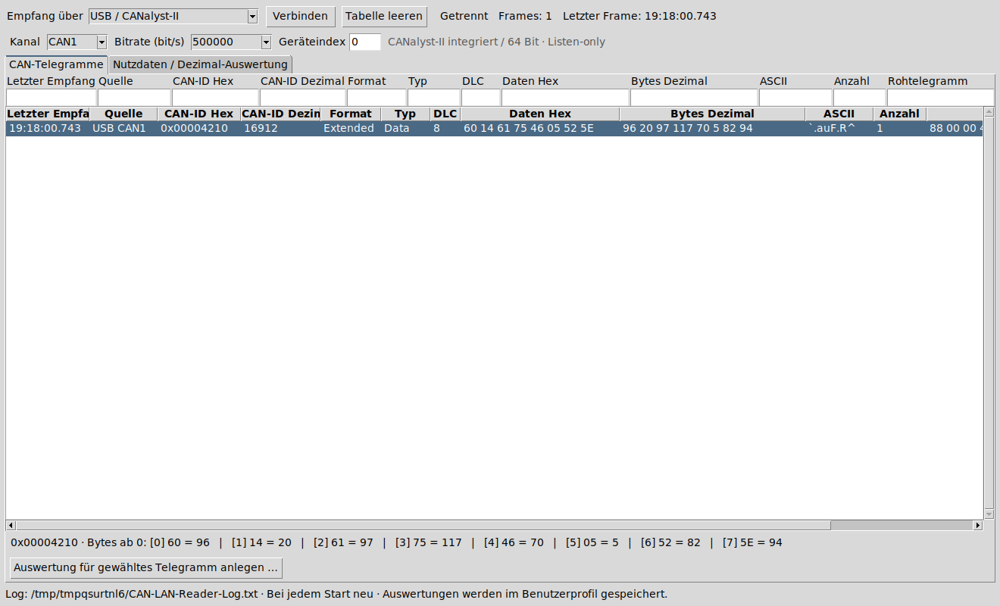
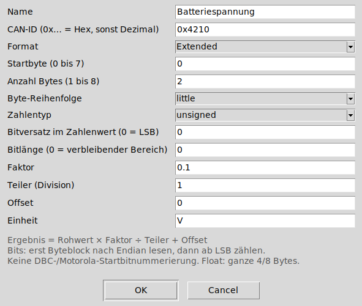
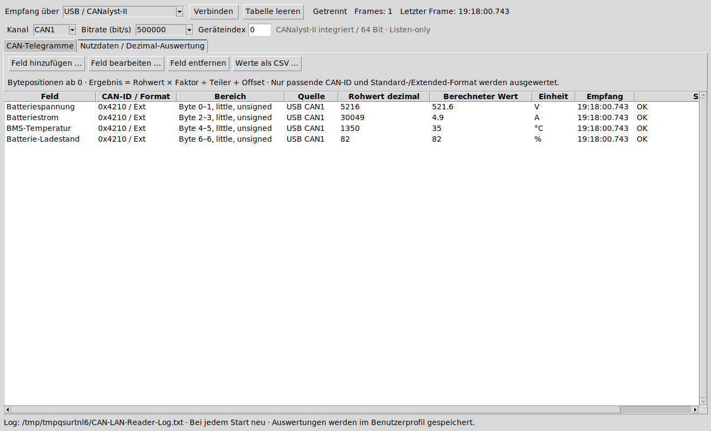

# CAN LAN / USB Reader 1.1.1

Windows-Programm zum lesenden Empfang von Classic-CAN-Telegrammen über
Waveshare-CAN/LAN oder CANalyst-II-kompatible USB-Adapter (ControlCAN).
Die bisherige LAN-Einstellung 192.168.2.226:20005 bleibt voreingestellt.

## Download und Start

**[Windows-Installer herunterladen (.exe)](https://github.com/TheBam1990/CAN-LAN-Reader/releases/latest/download/CAN-LAN-Reader-Setup.exe)** · **[Portable ZIP herunterladen](https://github.com/TheBam1990/CAN-LAN-Reader/releases/latest/download/CAN-LAN-Reader-Windows-x64-portable.zip)** · **[Alle Releases und Prüfsummen](https://github.com/TheBam1990/CAN-LAN-Reader/releases)**

Windows 10/11, 64 Bit. Python ist auf dem Zielrechner nicht notwendig.

- **Installer:** `CAN-LAN-Reader-Setup.exe` öffnen und dem Assistenten folgen. Er installiert das Programm einschließlich `_internal` und CANalyst-Bibliothek für den aktuellen Benutzer und legt Verknüpfungen an. Administratorrechte sind dafür nicht erforderlich. Anschließend über das Startmenü oder die Desktop-Verknüpfung starten.
- **Portable:** Das ZIP vollständig entpacken und `CAN-LAN-Reader.exe` öffnen. Die EXE und der Ordner `_internal` müssen zusammenbleiben. Die EXE allein ist kein vollständiges Programmpaket.

Die ControlCAN-DLL ist bereits enthalten; eine DLL-Auswahl entfällt. Der Windows-USB-Gerätetreiber muss bei Bedarf separat installiert werden. Das Programm installiert ihn nicht automatisch und ist nicht digital signiert.

## LAN

LAN / Waveshare auswählen, IP und TCP-Port eintragen und Verbinden drücken.
Der Waveshare muss CAN nach Ethernet als transparente 13-Byte-CAN-Frames liefern.
Es werden keine Abfragen oder CAN-Steuertelegramme gesendet.

## USB / CANalyst-II

1. Den USB-Treiber des tatsächlichen Geräteherstellers installieren, falls Windows den Adapter noch nicht erkennt.
2. USB / CANalyst-II, CAN1 oder CAN2, Geräteindex (erstes Gerät: 0) und die passende CAN-Bitrate einstellen, anschließend Verbinden drücken.

Die 64-Bit-ControlCAN-Bibliothek ist im Programmordner enthalten und wird automatisch geladen. Eine DLL-Auswahl ist nicht mehr notwendig; alte gespeicherte DLL-Pfade werden ignoriert. Der identifizierte Adapter ist ein Chuangxin CANalyst-II (USB 04D8:0053). Die Bibliothek stammt aus dem offiziellen Waveshare USB-CAN-B SDK; Herkunft unter vendor/canalyst/SOURCE.txt im Quellpaket. Sie bleibt eine Herstellerkomponente mit eigenen Rechten. Der Windows-USB-Gerätetreiber wird nicht automatisch installiert.

CANalyst-III und CAN FD sind nicht unterstützt. Der Adapter muss für lokalen USB-Empfang am Windows-PC angeschlossen sein.

Die ControlCAN-Anbindung nutzt DeviceType 4, CAN-Kanal 0/1 und Mode 1
(Listen-only). Es gibt keinen VCI_Transmit-Aufruf und keinen normalen aktiven
Betriebsmodus. Im Nur-Lauschen-Modus bestätigt der Adapter auch keine CAN-Frames;
ein funktionierender Bus benötigt seine normalen aktiven Teilnehmer.

USB wurde mit einer simulierten ControlCAN-DLL geprüft; zusätzlich wird die echte Hersteller-DLL unter Windows-Python geladen und ihre API geprüft. Der Adapter wurde am Raspberry nur identifiziert. Empfang am Windows-PC ist noch am Gerät zu prüfen.

## Telegramm-Variablen / Auswertungen anlegen

Eine Auswertung liest bestimmte Bytes oder Bits eines Telegramms und berechnet daraus eine Zahl, beispielsweise Spannung, Strom, Temperatur oder Ladestand. Die Bedeutung der Bytes muss aus dem Protokoll des sendenden Geräts bekannt sein. Das Programm erkennt die Bedeutung nicht automatisch.

Die folgenden Screenshots zeigen die echte Programmoberfläche mit **simulierten Beispieldaten**. Schrift und Fensterrahmen können unter Windows abweichen. Es besteht in den Screenshots keine echte Verbindung zum Gerät.

### 1. Telegramm auswählen

Verbinden drücken und im Reiter **CAN-Telegramme** die gewünschte Zeile anklicken. Unten erscheint die Zuordnung der Bytepositionen zu Hex- und Dezimalwerten. Danach **Auswertung für gewähltes Telegramm anlegen …** anklicken.



Die CAN-ID und das Standard-/Extended-Format werden aus der ausgewählten Zeile übernommen. Ohne ausgewählte Zeile lässt sich über **Nutzdaten / Dezimal-Auswertung → Feld hinzufügen …** ebenfalls eine Auswertung anlegen; dann ID und Format selbst eintragen.

### 2. Felder ausfüllen



| Feld | Bedeutung / Beispiel |
|---|---|
| Name | Frei wählbarer Anzeigename, etwa Batteriespannung |
| CAN-ID | Mit `0x` als Hexzahl angeben, etwa `0x4210`. Ohne Präfix werden reine Ziffern als Dezimalzahl gelesen. |
| Format | Genau wie empfangen: Standard = 11 Bit, Extended = 29 Bit. `0x4210` benötigt Extended; eine kleine ID kann ebenfalls als Extended übertragen werden. |
| Startbyte | Erstes zu lesendes Byte: **0 bezeichnet das erste Byte**, 4 das fünfte. |
| Anzahl Bytes | Größe des Zahlenwerts, z. B. 2; der Bereich muss vollständig in den maximal 8 Datenbytes liegen. |
| Byte-Reihenfolge | `little`: niedrigwertiges Byte zuerst; `big`: höchstwertiges Byte zuerst. Laut Geräteprotokoll wählen. |
| Zahlentyp | `unsigned` ohne Vorzeichen; `signed` als Zweierkomplement; `float32` bzw. `float64` für IEEE-Gleitkommazahlen mit 4 bzw. 8 Bytes. |
| Bitversatz | Bei ganzen Bytes `0`. Sonst Anzahl der niederwertigen Bits, die übersprungen werden. |
| Bitlänge | Bei ganzen Bytes `0` = verbleibender Bereich. Für einen einzelnen Schaltzustand `1`. |
| Faktor | Multiplikation, beispielsweise `0.1` für eine Auflösung von 0,1 V. |
| Teiler | Division, normalerweise `1`; zum Teilen durch 100 hier `100` eintragen. Darf nicht 0 sein. |
| Offset | Wird zum skalierten Wert addiert; beispielsweise `-100` für die dokumentierte Temperaturkodierung. |
| Einheit | Nur der angezeigte Text, etwa V, A, °C oder %. Ändert die Berechnung nicht. |

**Berechneter Wert = Rohwert × Faktor ÷ Teiler + Offset.**

Faktor, Teiler und Offset akzeptieren Punkt oder Komma als Dezimaltrennzeichen im Eingabedialog.
Mit **OK** speichern. Es können mehrere Auswertungen für dieselbe CAN-ID angelegt werden.

### 3. Ergebnisse ansehen und bearbeiten

Im Reiter **Nutzdaten / Dezimal-Auswertung** erscheinen die Auswertungen untereinander mit Rohwert, berechnetem Wert, Einheit, Quelle, Empfangszeit und Status. Neue passende Telegramme aktualisieren die Werte. CAN-ID **und** Standard-/Extended-Format müssen übereinstimmen.



Eine Zeile markieren und **Feld bearbeiten …** drücken oder doppelt anklicken. Mit **Feld entfernen** löschen und mit **Werte als CSV …** die angezeigten Ergebnisse exportieren.

### Beispiel: vier Werte aus einem Batterie-Telegramm

Für das hier betrachtete Pylon-Hochvolt-Protokoll ergibt das beobachtete Extended-Telegramm `0x4210` mit den Bytes `60 14 61 75 46 05 52 5E` folgende Auswertungen. **Nur verwenden, wenn das tatsächliche Geräteprotokoll diese Belegung bestätigt**; andere CAN-IDs und Protokollvarianten können anders aufgebaut sein.

Für alle vier Felder: **Extended**, `little`, `unsigned`, Bitversatz `0`, Bitlänge `0`, Teiler `1`.

| Name | CAN-ID | Startbyte | Bytes | Faktor | Offset | Einheit | Ergebnis |
|---|---|---:|---:|---:|---:|---|---:|
| Batteriespannung | `0x4210` | 0 | 2 | 0.1 | 0 | V | 521,6 |
| Batteriestrom | `0x4210` | 2 | 2 | 0.1 | -3000 | A | 4,9 |
| BMS-Temperatur | `0x4210` | 4 | 2 | 0.1 | -100 | °C | 35 |
| Batterie-Ladestand | `0x4210` | 6 | 1 | 1 | 0 | % | 82 |

Die Temperatur ist hier die im Protokoll bezeichnete BMS-Temperatur. Ein Wechselrichter kann eine andere Temperatur, etwa einen Zell- oder Modulwert, anzeigen. Den Offset nicht zum Angleichen verschiedener Messgrößen verändern.

### Beispiel: einzelnes Bit auslesen

Für Bit 3 des ersten Datenbytes: Startbyte `0`, Anzahl Bytes `1`, `unsigned`, Bitversatz `3`, Bitlänge `1`, Faktor `1`, Teiler `1`, Offset `0`. Das Ergebnis ist 0 oder 1. Bit 0 ist das niederwertigste Bit.

Bei Bitfeldern wird zuerst der ganze gewählte Byteblock entsprechend der Byte-Reihenfolge als Zahl gelesen; danach wird ab dem niederwertigsten Bit gezählt. Das ist **keine DBC-/Motorola-Startbitnummerierung**. Float-Felder unterstützen keine zusätzliche Bit-Auswahl.

### Speicherung, Neustart und Fehleranzeigen

Auswertungen und Verbindungseinstellungen werden automatisch unter `%APPDATA%\CAN-LAN-Reader\settings.json` gespeichert und beim Neustart geladen. Die Einstellungssicherung ist benutzerbezogen, nicht an den Programmordner gebunden. Deinstallation entfernt diese Benutzereinstellungen nicht. Aktuelle Telegramme und Messwerte werden nach einem Neustart neu empfangen.

- **CAN-ID passt nicht zum gewählten Format:** ID mit `0x` schreiben und das tatsächlich empfangene Format wählen. Standard erlaubt maximal `0x7FF`; `0x4210` ist Extended.
- **DLC zu kurz:** Das Telegramm enthält weniger Bytes als die Auswertung benötigt. Startbyte und Länge anhand des Protokolls prüfen. Fehlende Bytes werden nicht mit Nullen ergänzt.
- **Keine Aktualisierung:** Verbindung, ID und Format prüfen. Manche Geräte antworten erst auf Abfragen eines vorhandenen Masters; der Reader sendet keine Abfragen.
- **Unerwarteter Zahlenwert:** Byteposition, Reihenfolge, Zahlentyp und Skalierung mit dem Geräteprotokoll vergleichen. Ein abweichender Wert an einem anderen Gerät kann eine andere Messgröße sein.

## Tabelle und Log

Die Telegrammtabelle zeigt CAN-ID in Hex und Dezimal, Datenbytes in Hex und einzeln in Dezimal, Standard-/Extended-Format, DLC, Quelle, Empfangszeit und Anzahl. Wiederholungen derselben ID, desselben Formats und derselben Quelle aktualisieren die Zeile; LAN- und USB-Quellen werden getrennt geführt. Die Filter über den Spalten wirken gemeinsam.

Alle Rohtelegramme werden unabhängig vom Tabellenfilter in `CAN-LAN-Reader-Log.txt` geschrieben. **Diese Datei wird bei jedem Programmstart neu begonnen.** Ist der Programmordner nicht beschreibbar, liegt das Log unter `Dokumente\CAN-LAN-Reader`.

## Build und Tests

Windows: build-windows.bat mit passender Python-Architektur starten.
Tests: python -m unittest discover -s tests -v und python test_parser.py.
Auf Linux benötigen die GUI-Tests einen Bildschirm, etwa xvfb-run.
Der portable Build ist ein normaler Programmordner ohne UPX. Der zusätzliche NSIS-Installer installiert diesen Ordner vollständig.

Installer bauen: nach dem PyInstaller-Build `makensis installer.nsi` ausführen (NSIS 3 erforderlich). Ausgabe: `dist/CAN-LAN-Reader-Setup.exe`.
Prüfsummen sind im Lieferumfang enthalten; Erkennungsfreiheit bei Virenscannern
ist nicht zugesichert.


Release-Paket erstellen (aus dem Projektordner):

```text
python scripts/package_release.py
makensis installer.nsi
```

Das Skript erzeugt Portable-ZIP, Quellpaket, Screenshots im Programmpaket und Prüfsummen unter `dist/release-1.1.1`. Den anschließend gebauten Installer aus `dist/CAN-LAN-Reader-Setup.exe` zusätzlich in diesen Release-Ordner kopieren und dessen SHA-256-Prüfsumme ergänzen. Die Herstellerbibliothek unter `vendor/canalyst` bleibt eine Komponente des Herstellers; die Herkunft ist in `SOURCE.txt` dokumentiert.
